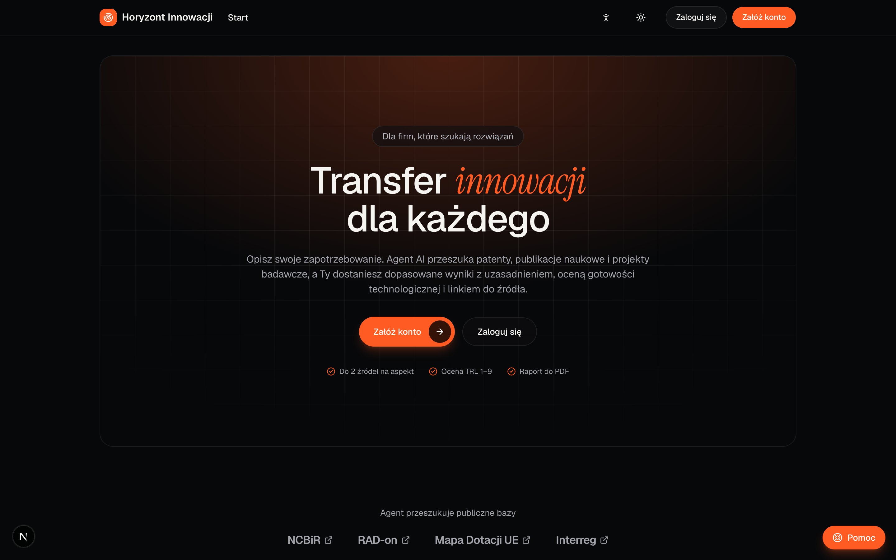
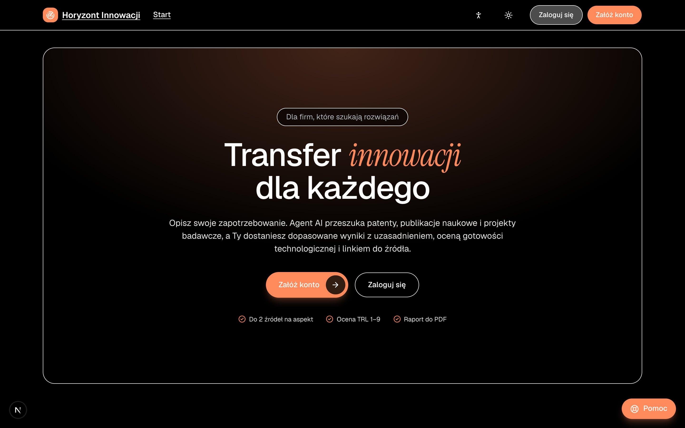
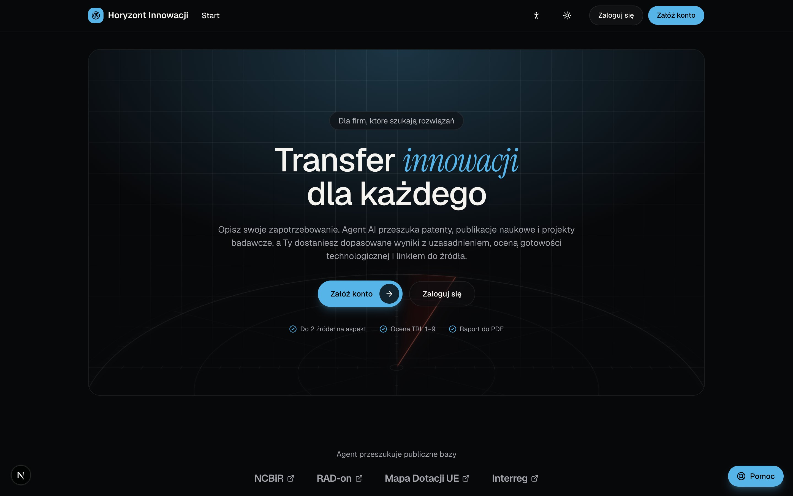

<div align="center">



# 📡 Horyzont Innowacji

**Transfer innowacji dla każdego.**

Znajdź gotową innowację, zanim zbudujesz ją od zera.

Agent AI przeszukuje publiczne bazy patentów, publikacji i projektów badawczych, a Ty dostajesz dopasowane wyniki z uzasadnieniem, oceną gotowości technologicznej (TRL) i linkiem do źródła.

[](https://innovation-radar-three.vercel.app/)


[Problem](#-problem-i-pomysł) · [Jak to działa](#-jak-to-działa) · [Zrzuty ekranu](#-zrzuty-ekranu) · [Funkcje](#-funkcje) · [Dostępność](#-dostępność) · [Studium przypadku](#-studium-przypadku) · [Dla jury](#-dla-jury-jak-wypróbować) · [Uruchomienie](#️-uruchomienie-lokalne)

</div>

---

## 🎯 Problem i pomysł

Rozwiązanie często **już istnieje**, tylko leży w bazie, której nikt nie przeszukał. Firmy budują od zera rzeczy, które od lat opisują projekty NCBiR, publikacje naukowe czy patenty. Horyzont robi to przeszukiwanie za nich, a **człowiek decyduje**, co zostaje.

Horyzont Innowacji powstał jako prototyp na **HackNation 2026 w Bydgoszczy** z inicjatywy [Podkarpackiego Centrum Innowacji](https://pcinn.org/). Użytkownik opisuje swój problem, AI proponuje frazy do wyszukiwarki, a agent przeszukuje wybrane publiczne bazy (NCBiR, RAD-on, Mapa Dotacji UE, Interreg) i pokazuje wyniki, które można zebrać w raport dla zespołu.

## 🧭 Jak to działa

Praca jest uporządkowana w pięciu poziomach. Wielu użytkowników może współtworzyć jeden projekt, dodając do niego własne aspekty.

1. **Opisz projekt.** Tytuł, opis, do 3 linków i do 3 plików PDF. AI proponuje uzupełnienia opisu.
2. **Zatwierdź frazy.** AI proponuje 3–5 fraz dla danego aspektu. Poprawiasz je, usuwasz, dodajesz własne i dopiero potem zatwierdzasz.
3. **Wybierz źródła.** Do dwóch baz na aspekt i liczba wyników. Agent szuka tylko tam, gdzie mu pozwolisz.
4. **Oceń wyniki.** Każdy wynik ma opis, uzasadnienie „dlaczego pasuje”, link do źródła i poziom TRL. Odznaczasz nieadekwatne i zatwierdzasz.
5. **Pobierz raport.** Zbiorcze opracowanie projektu w PDF z rekomendowanym następnym krokiem. Możesz też wysłać je całej organizacji.

### Skala TRL

Każdy wynik dostaje ocenę gotowości technologicznej, więc od razu widać, co można wdrożyć, a co rozwijać z partnerem naukowym. Wynik, którego nie da się ocenić ze źródła, liczymy jako TRL 2 i zaznaczamy to w raporcie.

| Grupa            | Poziomy | Znaczenie                                                 |
| ---------------- | ------- | --------------------------------------------------------- |
| 🔬 **Badania**   | TRL 1–3 | od obserwacji zjawiska po dowód słuszności koncepcji      |
| 🛠️ **Prototyp**  | TRL 4–6 | walidacja w laboratorium i demonstracja prototypu         |
| 🚀 **Wdrożenie** | TRL 7–9 | prototyp w warunkach rzeczywistych, system w eksploatacji |

## ✨ Funkcje

**Praca nad projektem**

- 🏢 **Organizacje i osoby**: wiele organizacji (NIP, adres, branża), dodawanie osób z istniejącymi kontami, role administratora i członka. NIP jest unikalny i po utworzeniu nie podlega edycji, a przy duplikacie aplikacja pokazuje e-mail administratora istniejącej organizacji.
- 📊 **Statystyki aktywności**: na stronie organizacji widać, ile projektów i aspektów dodała każda osoba.
- 📁 **Projekty**: opis problemu, do 3 linków i do 3 plików PDF (po 20 MB), numeracja, duplikowanie i filtrowanie listy (szukanie i organizacja). Karta pokazuje autora, autorów aspektów, użyte bazy i rozpiętość TRL.
- ✍️ **Asystent opisu**: AI proponuje uzupełnienia, a użytkownik dodaje wybrane jednym kliknięciem.
- 🧩 **Aspekty**: lista z frazami, użytymi bazami, liczbą wyszukiwań, rozpiętością TRL i autorem, z filtrem zakresu TRL. Cudzy aspekt można podejrzeć, a edytować i usuwać może tylko autor.
- 📄 **Raport projektu**: pobierany od razu jako plik PDF (rozpiętość TRL, rekomendowany następny krok, wszystkie aspekty i wyniki), z możliwością wysłania e-mailem do członków organizacji. Po wysłaniu projekt jest zamknięty do edycji.

**AI i wyszukiwanie**

- 🔤 **Frazy**: 3–5 fraz po polsku, edytowalnych i zatwierdzanych przez człowieka.
- 🤖 **Agent wyszukujący**: szuka w wybranych źródłach i zwraca wyniki z uzasadnieniem, oceną TRL i linkiem pochodzącym z faktycznych wyników wyszukiwania.
- ➕ **„Znajdź więcej”**: dokładanie kolejnych materiałów bez powtórzeń. Te same frazy w ciągu 7 dni wracają z zapisu bez kosztu.

**Strona publiczna i społeczność**

- 🏠 **Strona główna**: animowany radar, opis platformy z rozwijaną skalą TRL, struktura pracy, losowe aspekty „dla inspiracji”, linki do baz, FAQ.
- 📰 **Artykuły**: o korzyściach z innowacji i o ich finansowaniu.
- 📣 **Udostępnianie**: przyciski LinkedIn, Facebook, X i kopiowanie linku.
- 🛟 **Pomoc na każdej stronie**: zgłoszenie problemu z Horyzontem, problemu ze źródłem lub propozycji zmiany. Zgłoszenia trafiają do panelu administratora.

**Administracja i koszty**

- 🛡️ **Panel administratora**: źródła wyszukiwania, czarne listy (e-maile i tematy), limity, dodatkowe wytyczne dla AI i podgląd zgłoszeń.
- 💸 **Kontrola kosztów**: limity uruchomień agenta i generowań na użytkownika oraz tryb testowy `AGENT_MOCK`.

## ♿ Dostępność

Horyzont ma dwa tryby dostępności w menu „Ułatwienia dostępu” (w nagłówku, a na telefonie w menu hamburger). Wybór zapamiętuje się w przeglądarce i działa bez migotania przy ładowaniu strony. Domyślny jest ciemny motyw.

<table>
  <tr>
    <td width="50%"></td>
    <td width="50%"></td>
  </tr>
  <tr>
    <td align="center"><sub><b>Tryb WCAG</b>: kontrast co najmniej 7:1, podkreślone linki, wyraźny fokus, większa czcionka, bez animacji</sub></td>
    <td align="center"><sub><b>Tryb dla daltonistów</b>: paleta Okabe-Ito (niebieski i pomarańczowy zamiast czerwieni i zieleni)</sub></td>
  </tr>
</table>

## 🧠 Studium przypadku

Celem było zbudowanie działającego prototypu, w którym firma przechodzi całą drogę: od opisu problemu, przez frazy, po listę gotowych rozwiązań z linkami do źródeł.

### Człowiek decyduje, AI proponuje

Każdy etap AI jest tylko propozycją. Frazy użytkownik edytuje i zatwierdza, listę wyników odznacza, a dopiero potem zapisuje. Wyniki nie są zapisywane przy generowaniu, tylko przy zatwierdzeniu aspektu.

### Wiarygodne wyniki

Agent szuka wyłącznie w domenach wskazanych źródeł. Serwer porównuje linki zwrócone przez model z adresami, które naprawdę zwróciło wyszukiwanie, i odrzuca resztę. Dzięki temu model nie może podać zmyślonego linku.

### Koszty pod kontrolą

Model Haiku, ograniczona liczba wyszukań, limity na użytkownika w oknie 30 minut, cache wyników na 7 dni i wymuszone odpowiedzi w formacie JSON (narzędzia ze schematem Zod) utrzymują koszt pojedynczego uruchomienia na niskim poziomie.

### Pliki i bezpieczeństwo

Pliki PDF trafiają prosto z przeglądarki do prywatnego bucketu R2 przez krótko ważne podpisane adresy. Serwer sprawdza potem rozmiar i sygnaturę pliku. Każda akcja serwerowa weryfikuje sesję i dostęp do organizacji, a rola administratora jest sprawdzana po stronie serwera.

## 🧪 Dla jury: jak wypróbować

1. Wejdź na działający prototyp: **https://innovation-radar-three.vercel.app/**
2. Zaloguj się kontem testowym:

   | Pole   | Wartość                         |
   | ------ | ------------------------------- |
   | E-mail | `vojciechkwiatkowski@gmail.com` |
   | Hasło  | `Mini12345!`                    |

   Możesz też założyć własne konto (imię, nazwisko, e-mail i hasło) i potwierdzić adres linkiem z wiadomości.

3. Po zalogowaniu przejdź ścieżkę:
   - **Organizacje**: dodaj firmę (NIP, adres) i, jeśli chcesz, osoby z istniejącymi kontami.
   - **Projekty**: opisz problem, dodaj linki lub pliki PDF.
   - **Aspekty → Nowy aspekt**: wybierz projekt, wygeneruj i zatwierdź frazy, kliknij „Szukaj w źródłach” (do minuty), a potem zatwierdź listę wyników.
   - **Projekty → Pobierz raport (PDF)** albo „Wyślij raport” do członków organizacji.
4. Przycisk **Pomoc** (prawy dolny róg) pozwala zgłosić problem lub pomysł.

## 📚 Dokumentacja

Opis projektu: [`docs/PROJECT.md`](docs/PROJECT.md), plan agenta: [`docs/AGENT.md`](docs/AGENT.md), wytyczne organizatorów: [`docs/CHALLENGE.md`](docs/CHALLENGE.md).

## 🛠️ Stack technologiczny

| Warstwa                    | Technologie                                      |
| -------------------------- | ------------------------------------------------ |
| **Framework**              | Next.js 16 (App Router), React 19, TypeScript    |
| **Style i komponenty**     | Tailwind CSS 4, shadcn (Base UI), Lucide         |
| **Baza danych**            | Prisma 7 + Neon (PostgreSQL)                     |
| **Uwierzytelnianie**       | Better Auth (e-mail i hasło, weryfikacja adresu) |
| **Formularze i walidacja** | React Hook Form + Zod 4                          |
| **AI i agent**             | Claude API (Haiku) z narzędziem `web_search`     |
| **Raporty PDF**            | `@react-pdf/renderer` (generowane na serwerze)   |
| **Pliki**                  | Cloudflare R2 (PDF, podpisane adresy)            |
| **E-mail**                 | Resend                                           |
| **Narzędzia**              | React Compiler, ESLint, Prettier                 |
| **Hosting**                | Vercel                                           |

### Struktura repozytorium

Jeden plik na encję, bez rozproszenia logiki:

```text
src/
├── app/            strony i trasy API (App Router)
├── actions/        akcje serwerowe (tylko mutacje)
├── queries/        odczyty z bazy
├── validation/     schematy Zod, typy i etykiety
├── components/     komponenty (project/, search/, landing/, shadcn/ …)
└── lib/            baza, agent AI, raport PDF, TRL, treści strony głównej
prisma/             schemat bazy i dane demo (seed)
docs/               opis projektu, wytyczne organizatorów, plan agenta, zrzuty ekranu
tests/              testy reguł domenowych
```

## ⚙️ Uruchomienie lokalne

### Wymagania

- [Node.js](https://nodejs.org/) 20+ i npm
- Baza PostgreSQL, np. darmowa na [Neon](https://neon.tech/)
- Opcjonalnie: klucz [Anthropic](https://console.anthropic.com/) (agent i frazy), konto [Resend](https://resend.com/) (e-maile) i bucket Cloudflare R2 (pliki PDF)

### Instalacja

**1. Sklonuj repozytorium**

```bash
git clone https://github.com/rafalski-dev/innovation-radar.git
cd innovation-radar
```

**2. Zainstaluj zależności** (generuje też klienta Prismy)

```bash
npm install
```

**3. Ustaw zmienne środowiskowe**

Skopiuj `.env.example` do `.env` i uzupełnij:

```env
# Wymagane
DATABASE_URL=postgresql://...            # connection string z Neona
BETTER_AUTH_SECRET=...                   # openssl rand -base64 32
BETTER_AUTH_URL=http://localhost:3000

# Opcjonalne
ADMIN_EMAILS=ty@example.com              # konta z tym adresem dostają rolę ADMIN
ANTHROPIC_API_KEY=...                    # bez klucza agent i frazy nie działają
AGENT_MOCK=true                          # przykładowe wyniki bez wywołań API
RESEND_API_KEY=...                       # bez klucza linki trafiają do konsoli serwera
R2_ACCOUNT_ID=...                        # pliki PDF (R2_*)
R2_ACCESS_KEY_ID=...
R2_SECRET_ACCESS_KEY=...
R2_BUCKET=...
```

> Bez `RESEND_API_KEY` aplikacja działa: link weryfikacyjny i reset hasła wypisują się w konsoli serwera. Bez zmiennych `R2_*` wyłączone jest tylko dodawanie plików PDF.

**4. Utwórz tabele i dane demo**

```bash
npm run db:push
npm run db:seed
```

Seed tworzy źródła wyszukiwania oraz (tylko do lokalnego developmentu) konto demo `demo@radar-innowacji.pl` z hasłem `DemoRadar2026!`, jedną organizację, projekty i przykładowy aspekt z wynikami. Konto demo ma też rolę administratora.

**5. Uruchom serwer deweloperski**

```bash
npm run dev
```

Aplikacja działa pod adresem **http://localhost:3000**.

### Skrypty

`dev`, `build`, `typecheck`, `lint`, `format`, `test`, `db:push`, `db:seed`, `db:studio`. Zasady kodu: [`CLAUDE.md`](CLAUDE.md).

---

<div align="center">

Aplikacja powstała z inicjatywy **HackNation 2026 w Bydgoszczy** oraz [Podkarpackiego Centrum Innowacji](https://pcinn.org/).

</div>
